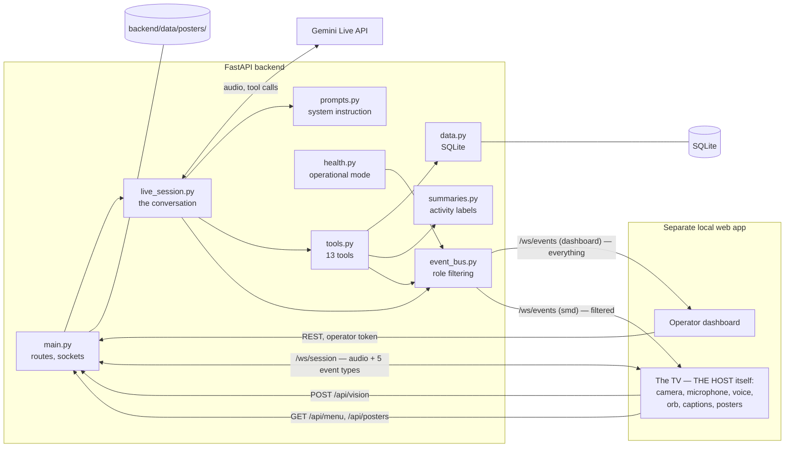

# THE HOST

**A Real-Time Multimodal Agentic AI Host for Intelligent Customer Interaction and Order
Management.**

> See. Understand. Act.

THE HOST is an AI host for a food stall. It notices a guest arriving, greets them in its own
voice without being asked, talks with them, recommends what is actually in stock, takes a
real order and holds it to a spoken confirmation, remembers a returning guest by the name
they gave, and announces orders out loud when they are ready — while three people and one
dashboard stay in charge of everything it does.

It was built for **Bite & Pour**, a student food stall at the GCUF Business Gala. It runs on
one laptop, uses only free-tier services, and is built so that every number on a screen comes
from the database and never from a guess.

---

## The stall: two screens

| Screen | What it is |
|---|---|
| **The TV**, on top of the stall | THE HOST itself. The camera, the handheld microphone and THE HOST's voice all belong to this page. When nobody is talking it shows the stall's posters, full screen. There is not one button on it: the operator taps it once at the start of the day and never touches it again. |
| **The laptop**, on the front table | The operator's dashboard. The live conversation, the activity feed, the orders, the earnings, the visitor memory and every control. It is the only screen a guest's name is ever printed on. |

THE HOST never replaces the team; it hands work to them. A guest who needs a person gets one.

## What it does

1. A guest walks up. The browser's on-device detector notices a person and reports presence
   to the backend, which opens a conversation on its own — nobody has to press anything.
2. THE HOST greets the guest in its own voice and listens. Speech goes both ways over one
   WebSocket as raw audio; the transcript appears live on the operator's screen.
3. The guest asks what's good. THE HOST checks the real menu, recommends something that is
   actually in stock, and answers questions about the stall, the team and the project.
4. The guest orders. THE HOST reads the order back and asks one question — *"Shall I place
   it — cash or QR?"* — and then stops. Nothing is placed until the guest answers, and that
   is enforced by the backend, not by good manners.
5. The guest pays at the counter. The team presses **Paid · Cash** or **Paid · QR**, and
   only then does the order reach the kitchen. THE HOST tells the guest in one line that it
   is paid and on its way.
6. A guest who changes their mind can change or cancel the order by talking, for as long as
   nobody has taken the money for it.
7. If the guest gives a name, THE HOST remembers it — the name on the order is enough. Next
   time it welcomes them back by name and knows their usual. It never recognises a face.
8. The guest can hold something up and ask "what is this?" — or THE HOST can ask the page
   for a picture itself when a question needs eyes.
9. The operator marks the order ready. THE HOST waits for a gap in the conversation and then
   announces it out loud, and the TV shows it.

## Key features

- **Unprompted greeting** from on-device presence detection — no wake word, no button.
- **Live voice both ways** through the Gemini Live API (16 kHz in, 24 kHz out), with
  barge-in: a guest can talk over THE HOST and it stops.
- **Orders numbered 1, 2, 3.** The guest is given a number the moment their order is placed,
  and that is the number THE HOST says, the TV calls out when it is ready, and the dashboard
  and the CSV show. Numbers run in sequence through the day and start again each morning; a
  draft has none, because nothing has been placed yet.
- **Pay first, then the kitchen.** An order is placed and then waits for the money: THE HOST
  asks *cash or QR* while placing it, the guest pays at the counter, and the team presses
  **Paid · Cash** or **Paid · QR** on the dashboard. Only that press sends it to the kitchen,
  and THE HOST tells the guest in one line that it is paid. An order nobody comes to pay for
  is cancelled by itself after ten minutes.
- **Orders the code will not let it get wrong.** A backend guard refuses `confirm_order`
  outright unless the guest's own last line was a yes — or their answer to *cash or QR*. The
  same guard protects a cancellation.
- **Changes to a placed order, by voice.** Remove an item, swap it, or cancel it, for as long
  as nobody has taken the money. A change places the corrected order *first* and cancels the
  old one after, so the guest is never left with nothing.
- **A guest-of-honour protocol.** The Vice Chancellor of the university is the stall's guest:
  no name asked, no price spoken, the order marked *on the house* for the team to see. Who
  qualifies is decided in code, not in a prompt — every other guest, however they introduce
  themselves, is a paying guest.
- **A returning guest is welcomed back.** The name THE HOST is given for an order is the
  name it remembers, so a guest who comes back a second time is greeted as one.
- **A line to THE HOST from the team.** A text box on the dashboard tells THE HOST something
  mid-conversation — *"this is the Vice Chancellor"*, *"ask them to pay at the counter"* — and
  it acts on it at once, without ever reading it out or mentioning it.
- **Earnings you can count against the cash box.** Every payment records Cash or QR, the
  dashboard totals the two separately alongside what is still waiting at the counter and what
  had to be refunded, and one button downloads the day's sales as a CSV.
- **Feedback from the guests themselves.** A QR card on the table opens a short form; the
  reviews come back into THE HOST once a minute and sit on a **Feedback** page beside the
  feedback guests give THE HOST out loud, with the averages, both lists and a CSV.
- **The stall's posters on the TV.** Drop pictures into a folder and the idle screen becomes
  a full-screen poster rotation, 8 seconds each, no text over them, no restart needed.
- **Recovery from a real outage.** A dropped Gemini connection is rebuilt for a full thirty
  seconds, the page says *Reconnecting…*, and the open order is handed back from the database.
  The TV then finds its own way back to its idle screen without anybody reloading it — and
  when it does need a reload, there is a button for that on the dashboard.
- **Privacy by construction.** No face recognition, no stored pictures, no recordings, and no
  guest's words in any log or file.
- **13 tools** the model can call, each validating its own input and reading live data.
- **An 11-state conversation machine** that drives the orb on the TV and the dashboard label.
- **One event bus, two audiences.** The operator's dashboard sees everything; the public
  screen is filtered in the backend, so a guest's name can never reach it.
- **Operator controls**: pause, take over, end a conversation, advance or cancel an order,
  mark an item sold out, re-announce, correct or forget a visitor, and a demo mode of last
  resort.
- **Honest failures.** Every failure produces a plain spoken sentence and a visible mode
  change, never a traceback and never invented data.

## Architecture



Two WebSockets, deliberately separate:

- **`/ws/session`** is the audio path. It carries binary PCM both ways and only five JSON
  event types. A slow or dead observer can never touch it.
- **`/ws/events`** is a read-only observer stream. Everything published goes through it,
  filtered per role, with a per-socket send timeout so a stuck client is dropped instead of
  stalling a conversation.

## How it works

**Conversation state machine.** One value at a time, sent only when it really changes:
`IDLE`, `GREETING`, `SEEING`, `LISTENING`, `THINKING`, `SPEAKING`, `RECOMMENDING`,
`TAKING_ORDER`, `ANNOUNCING`, `REMEMBERING`, `NEEDS_HELP`. While an order is being taken the
label holds at `TAKING_ORDER`; only `SEEING`, `REMEMBERING`, `ANNOUNCING` and `NEEDS_HELP`
may interrupt it, each returning to the resting state at the end of the turn. The
conversation ends after 45 seconds of real silence, or gently after about 8 minutes: audio
still playing and a guest still talking both count as activity, so neither a long answer
nor a reply is ever cut off mid-sentence. It also ends if nobody has been in front of the
camera for 20 seconds, so THE HOST never talks to an empty room.

**Waking up.** A guest never has to press anything. THE HOST greets whoever walks up, and
once a conversation is over it can also start again on speech alone — but only when a face
is close to the counter **and** looking at the screen **and** a voice is heard for more
than half a second. All three together, because sound on its own cannot tell a guest from
two people chatting beside the stall. While the booth waits, the microphone is open for a
loudness reading only: nothing is recorded, and no audio leaves the browser until a
conversation actually starts.

**The polite wrap-up.** At about 8 minutes THE HOST is asked to say goodbye in one short
sentence rather than the screen cutting the conversation off. It waits for a gap first —
never mid-order, mid-answer or mid-sentence — and only then ends, so the last thing a guest
hears is a thank-you and not silence.

**Pay first, and a guard that does not take the model's word for it.** `build_order` creates
a draft in `PENDING_CONFIRMATION`. THE HOST reads it back and asks one question — *"Shall I
place it — cash or QR?"* — and the answer is both the yes and the payment: `confirm_order`
carries `CASH` or `QR` and leaves the order in `AWAITING_PAYMENT`. The guest pays at the
counter, the team presses **Paid · Cash** or **Paid · QR**, and only that press moves the
order to `CONFIRMED`, stamps when it was paid, and sends it to the kitchen. THE HOST is told,
and says in one line that it is paid.

What makes it safe is that the backend checks the guest's own last line before letting
`confirm_order` run at all: no answer, no order, whatever the model intended. "Yes", "haan",
"ji", "confirm" and "go ahead" all count, in English and in Urdu, and so do "cash", "QR",
"online" and "scan"; silence, a new sentence or an answer to a different question do not, and
THE HOST is told to ask again. A cancellation has the same guard, in reverse: it needs the
guest's consent, in this conversation, after the order was placed. A draft that is abandoned
is cancelled after five minutes, and an order nobody pays for after ten. From there the
operator moves the order `CONFIRMED → PREPARING → READY → COLLECTED`, one step at a time;
`CANCELLED`, `FAILED` and `REQUIRES_ATTENTION` are the other three statuses, the last two
operator-only.

**Changing a placed order.** Once an order is placed it is final — but a guest may still
change their mind out loud, and THE HOST checks the order's real status before it agrees.
While the order is still waiting for payment it can remove an item, replace the order, or
cancel it; once the money has been taken THE HOST says so plainly and raises it with the team
instead, refund and all. A change is done new-first: the corrected order is confirmed *before* the old one is
cancelled, so a failure in the middle leaves the guest with the order they had rather than
with nothing. Adding something to a confirmed order is always a new, separate order, and THE
HOST says so.

**Guests of honour.** The Vice Chancellor of the university is the stall's guest: THE HOST
greets him formally, thanks him on the team's behalf, tells him it is on the house, takes the
order without asking for a name and without speaking a price, and hands the hard technical
questions to the project lead by name. Whether an order may be on the house is not left to
the prompt — the backend stores that flag only for the Vice Chancellor's own name, logs every
refusal, and tells the model plainly that it was refused. A chief guest, a judge, a teacher
or anyone who says they are staff gets the same formality and respect and a perfectly normal
bill. The dashboard shows an on-the-house order badged *On the house* and the activity feed
reads `Order #29 created (on the house)`, so the team can always see it and check.

**How THE HOST sounds.** One short style rule runs through everything it says: a polished,
confident host with quiet wit, one or two sentences unless detail is asked for, varied
wording rather than the same opener twice, a decisive "Done — one Chicken Burger for Rehman."
instead of a paragraph, the guest's name once or twice rather than in every line, two or
three suggestions rather than the whole menu read out, at most one light joke in a
conversation and none at all with a guest of honour, and none of the assistant filler
("Great question", "Absolutely!", "How can I help you?") that makes a stall sound like a
chatbot. It replies in the language of the guest's last line — English, Urdu or Roman Urdu,
always with the polite *aap*.

**The money.** Every order records how the guest paid, at the moment they pay: the dashboard
offers **Paid · Cash** and **Paid · QR** on an order waiting at the counter, and the backend
refuses the payment with neither. Handing the food over afterwards is one **Collected**
button, because by then the payment is already on the order. The Earnings panel shows the
day's total split into cash and QR, what is still waiting for payment, what went on the
house, and what had to be refunded, with a breakdown by item — and
**Download today's sales (CSV)** saves one row per order, with the time it was paid, so the
figures can be checked against the cash box and the QR account at the end of the night.

**A line to THE HOST, from the team.** Rehman can type into the Live conversation panel while
a guest is still talking — *"this is the Vice Chancellor"*, *"ask them to pay at the
counter"*, *"wrap up politely"* — and THE HOST acts on it at once as though it had thought of
it itself. It never reads the note out and never mentions that it got one, and nothing typed
there is written to the log, the activity feed or the database: the feed says only *Operator
note sent*.

**The posters on the TV.** When no conversation is running and no announcement is showing,
the TV shows the stall's own pictures full screen — one at a time, 8 seconds each, with a
soft cross-fade, letterboxed on the display's background colour, and with no text, logo,
caption or control over them, because each poster already carries everything it needs to
say. The list is read from the backend every minute, so a poster added during the evening
appears by itself. With no posters at all the TV shows its brand screen.

**Role-filtered event bus.** Every event is stamped once with a monotonic `event_id`, a
local timestamp and a session id, then delivered to each observer through a filter table.
The public display never receives the activity feed, memory updates, vision detections or
system status; guest names are stripped from every order it does receive, and it sees only
completed transcript lines, never partials.

**The announcement.** Moving an order to `READY` flips an atomic `announced` flag, so the
same order can never be announced twice. The order-ready event goes to both screens, and if
a conversation is running THE HOST speaks the announcement itself. It waits for a gap: an
announcement is never injected while a model turn is producing output, while the guest is
mid-sentence, or while the TV's microphone meter says the guest is talking, because doing so
makes the model cut its own sentence off. Even in a gap it waits 0.8 seconds and looks
again, since a guest's first syllable reaches the room before it reaches the backend.
Deferred announcements leave one per turn end, or as soon as the guest falls silent. An
order leaves the pending list only once THE HOST has finished saying it, and an order THE
HOST has already announced is never handed to the display a second time. An order that
becomes ready between conversations gets the banner and one soft chime on the TV — THE HOST
has one voice, and the screen never speaks in another.

**Memory by name, never by face.** A profile is created only when a guest clearly says a
name. The key is the lower-cased name; there is no biometric data anywhere in the system,
and the camera is used only for presence counting and for pictures the guest asks about.
An operator can correct a misheard name or delete a profile outright.

**What the menu can say.** Besides a name, category, price and description, a menu item may
carry four optional facts: `ingredients`, `allergens`, `tags` (any of `spicy`, `sweet`,
`vegetarian`, `cold`, `hot`) and `add_ons` — the extras the stall genuinely offers. They are
answered from the data or not at all: a field that is missing means **unknown**, never
"none", so THE HOST says it does not have that detail and points the guest at the counter
rather than inventing a garnish. Allergy questions are never answered with a guarantee.

## Tech stack

| Layer | Choice |
|---|---|
| Backend | Python 3.13, FastAPI, Uvicorn |
| AI | Gemini Live API via `google-genai` (audio in/out, function calling) |
| Storage | SQLite (single local file) |
| Dashboard and TV | TanStack Start (React), Web Audio API, MediaPipe face detection for presence |
| Tests | pytest, vitest |

No paid services and no cloud database.

## Getting started (Windows)

**Prerequisites:** Python 3.13, Google Chrome, [bun](https://bun.sh) for the dashboard, and a
Gemini API key from Google AI Studio.

```powershell
# 1. Get the code
git clone https://github.com/Rehman-ayoub333/The_Host.git
cd The_Host

# 2. Create and activate a virtual environment at the repository root
python -m venv .venv
.\.venv\Scripts\Activate.ps1

# 3. Install the backend dependencies
pip install -r backend\requirements.txt

# 4. Create your own configuration from the example and add your key
Copy-Item backend\.env.example backend\.env
notepad backend\.env

# 5. Start the backend and the dashboard, each in its own window
.\scripts\start-all.ps1
```

Then open the TV's screen with `.\scripts\open-display.ps1`. It opens
**http://localhost:8080/display** full screen on the second monitor, in a browser profile of
its own, and asks once — the first time only — for the camera and the microphone; allow both.
After that it starts itself every time, with no tap and no keyboard, which is what lets the
dashboard's **Reload display screen** button work from across the stall. Use `-X 0` to open
it on the laptop instead while testing, or open the address by hand and tap the screen once.

The camera and the microphone themselves are chosen on the laptop, in the dashboard's
Settings. The TV greets a guest on its own, so it must be a visible window of its own —
presence detection pauses while the tab is hidden. A partly overlapped window is fine; a
minimised one is not.

`http://127.0.0.1:8000/` is the backend, not a screen: it answers with one line saying where
the display is.

### The scripts

Everything is a script, run from the repository root:

| Script | What it does |
|---|---|
| `.\scripts\start-all.ps1` | Starts the backend on `127.0.0.1:8000` and the dashboard on `localhost:8080`, each in its own window |
| `.\scripts\start-backend.ps1` | The backend only |
| `.\scripts\start-dashboard.ps1` | The dashboard only — runs `bun install` first if `node_modules` is missing |
| `.\scripts\open-display.ps1` | Opens the TV's own full-screen browser window on the second screen |
| `.\scripts\preflight.ps1` | One PASS/FAIL/WARN line per readiness check, for the day of the event |
| `.\scripts\stop-all.ps1` | Stops both servers, by port. Closing the windows is **not** enough |
| `.\scripts\reset-for-gala.ps1` | Starts the event with an empty database, keeping the old one as a backup |
| `.\scripts\run-tests.ps1` | The full backend suite (any extra arguments go straight to pytest) |

No script reads, prints or echoes your `.env`. `preflight.ps1` only checks that the file
exists; it never opens it, and no script ever reads or prints the operator token.

**Running the stall on the day:** [docs/GALA-RUNBOOK.md](docs/GALA-RUNBOOK.md) — setup,
roles, the kitchen flow, the operator buttons, the guest-of-honour protocol, and what to do
when the internet drops.

## The menu and the posters

Both are data, not code. Neither needs a rebuild, a migration or a developer.

**The menu** lives in `backend/data/menu.json`: one object per item with `name`, `category`,
`price`, `description`, `available` and, optionally, `image_url`, `prep_seconds`,
`ingredients`, `allergens`, `tags` and `add_ons`. The file is the source of truth and is
synced into the database at every start, so editing it and restarting the backend is all
that changing the menu takes. An item can also be marked sold out and back again from the
dashboard, live, without touching the file.

**The posters** are picture files in `backend/data/posters/` — `.jpg`, `.jpeg`, `.png` or
`.webp`, 1920×1080 landscape, one picture per poster, shown in file-name order. Name them
`01-…`, `02-…` and so on to set the order. The folder is read on every request, so a poster
dropped in during the evening appears on the TV within a minute, with nothing to restart.
Anything else in the folder, including its `README.txt`, is ignored.

## Configuration

Every value lives in `backend/.env`; `backend/.env.example` lists them all. **Put no real
secret in any file that is committed.**

| Variable | Purpose | Default |
|---|---|---|
| `GEMINI_API_KEY` | Your Gemini API key. Required; the backend refuses to start without it. | none |
| `GEMINI_LIVE_MODEL` | The Gemini Live model to connect to. | `gemini-3.8-live` |
| `GEMINI_VOICE` | The prebuilt voice THE HOST speaks with. | `Sulafat` |
| `OPERATOR_TOKEN` | Shared secret for every privileged endpoint and the dashboard event stream. Without it those are all refused. | none |
| `AGENT_NAME` | The name the agent uses for itself. | `THE HOST` |
| `STALL_NAME` | The stall the agent says it works at. | `Bite & Pour` |
| `MENU_JSON_PATH` | Seed file the menu table is synced from at every start. | `./data/menu.json` |
| `BUSINESS_INFO_JSON_PATH` | Seed file for the stall facts the agent may state. | `./data/business_info.json` |
| `POSTERS_DIR` | The folder of poster pictures the TV shows when it is idle. | `./data/posters` |
| `DB_PATH` | The SQLite file. | `./data/the_host.db` |
| `LOG_DIR` | Where the day's log file is written. | `./logs` |
| `CORS_ALLOW_ORIGINS` | Comma-separated origins allowed to call the API. No wildcard. | `http://localhost:8080,http://localhost:5173,http://localhost:4173` |
| `PORT` | Port recorded for the frontends to use. | `8000` |
| `VISION_SEND_MODE` | How a snapshot reaches the model: `client_content` (picture and question as one turn) or `realtime` (two calls). | `client_content` |
| `NETLIFY_TOKEN` | A Netlify personal access token, so the guests' feedback forms can be read. Leave it blank and the import is simply off. | *(blank)* |
| `NETLIFY_SITE_ID` | The API ID of the Netlify site the feedback form is published on. | *(blank)* |
| `NETLIFY_FORM_NAME` | The form's name in Netlify, which is what the page posts as `form-name`. | `feedback` |

`.env` is never committed and the key is only ever read by the backend process. It is never
logged, never sent to a browser, and never written into any file by the application. The same
holds for `NETLIFY_TOKEN`: a failed import logs the exception type and nothing else.

## REST and WebSocket reference

**Token** means the `X-Operator-Token` header. Everything that returns guest data or changes
anything requires it.

| Endpoint | Purpose | Token |
|---|---|---|
| `GET /health` | Status, model, menu row count, operational mode and per-component health | no |
| `GET /api/menu` | The menu | no |
| `GET /api/posters` | The poster file list, in file-name order, for the TV's idle screen | no |
| `GET /posters/{file}` | One poster picture | no |
| `POST /api/vision` | The browser reporting presence and detections. A report, never a command | no |
| `GET /api/orders` | Orders for the Orders panel, with tab counts | yes |
| `GET /api/visitors` | Recent visitor profiles | yes |
| `GET /api/activity` | Recent activity-feed entries | yes |
| `GET /api/analytics` | Real aggregates for today | yes |
| `GET /api/metrics` | Today's conversation, order, failed-tool and connection-failure counts | yes |
| `GET /api/earnings` | Today's money: total, cash, QR, waiting for payment, on the house, refunded, by item | yes |
| `GET /api/earnings.csv` | The day's sales as a CSV, one row per order | yes |
| `POST /api/orders/{id}/status` | Advance, cancel, fail or flag an order. The payment — `CONFIRMED` on an order waiting for one — must carry `payment_method` of `CASH` or `QR` | yes |
| `POST /api/menu/{name}/availability` | Mark an item sold out or available again | yes |
| `POST /api/operator/pause` | Pause THE HOST; any running conversation ends cleanly | yes |
| `POST /api/operator/resume` | Return to the computed mode | yes |
| `POST /api/operator/takeover` | The operator handles this one personally | yes |
| `POST /api/operator/takeover/end` | Hand it back | yes |
| `POST /api/operator/end-session` | Force-end whatever conversation is running | yes |
| `POST /api/operator/retry-connection` | Check the AI service right now and update the mode | yes |
| `POST /api/operator/announce` | Repeat the announcement for a ready order | yes |
| `POST /api/session/note` | A line for THE HOST from the team, 1–300 characters, while a conversation is running | yes |
| `POST /api/display/reload` | Ask the TV to reload itself | yes |
| `PATCH /api/visitors/{name_key}` | Correct a misheard name or a wrong favourite | yes |
| `DELETE /api/visitors/{name_key}` | Forget a visitor completely. Orders are untouched | yes |

| WebSocket | Purpose |
|---|---|
| `/ws/session` | The conversation: binary audio both ways plus `agent_state_changed`, `speech_transcript`, `interrupted`, `error` and `capture_request` |
| `/ws/events?role=dashboard` | Read-only observer stream for the operator. Also needs the operator token, passed as a query parameter because a browser cannot set a header on a WebSocket handshake |
| `/ws/events?role=smd` | Read-only observer stream for the public display, filtered in the backend |

**What the TV sends back on `/ws/session`:** microphone audio as raw PCM, `vision_frame` (one
JPEG, when the guest shows the camera something or THE HOST asks for a picture), `text_input`
(a typed line, when the microphone is unavailable) and `voice_activity` —
`{"active": true}` or `{"active": false}`, nothing else. It comes from the microphone meter
the orb already uses: no audio and no level ever leaves the page in it. It exists so the
backend knows the guest has started speaking before Gemini transcribes them, which is a
second or more earlier, and can hold an announcement back. Then `wrap_up`, sent once when the
conversation reaches its 8-minute cap, which asks THE HOST to thank the guest and say goodbye
in one sentence. Last, `session_end` with the reason the page stopped (`timeout`, `cap`,
`user`, `absent`), which the backend records; the socket closing is what actually ends the
conversation.

**Events on `/ws/events`.** Every one carries `event_id`, `timestamp` and `session_id`.

| Event | Meaning |
|---|---|
| `state_snapshot` | Sent once on connect: boot id, mode, current state, presence, active orders |
| `agent_state_changed` | The conversation state changed |
| `person_detected` / `person_left` | The browser's detector saw someone arrive or leave |
| `visitor_identified` | A spoken name matched a stored profile |
| `speech_transcript` | A line of speech, partial or complete, from the guest or the agent |
| `interrupted` | The guest talked over the agent and its audio was cut |
| `order_created` / `order_updated` | An order was drafted, or its status changed |
| `order_ready` | An order became ready and should be announced |
| `menu_updated` | An item was marked sold out or available |
| `memory_updated` | A visitor profile changed. Dashboard only |
| `recommendation` | The agent recommended a specific item |
| `vision_update` | What the browser's detectors currently report. Dashboard only |
| `agent_activity` | One line for the activity feed. Dashboard only |
| `system_status_changed` | A component the backend can actually observe changed. Dashboard only |
| `operational_mode_changed` | `ONLINE`, `OFFLINE`, `PAUSED` or `OPERATOR_TAKEOVER` |
| `capture_request` | The agent is asking the TV for one picture. Never public |
| `display_reload` | The operator asked the TV to reload itself. Display only |
| `error` | A plain, human-readable failure message |
| `heartbeat` | Every 10 seconds, so a client knows the stream is alive |

## Testing

```powershell
.\scripts\run-tests.ps1          # the backend suite
cd dashboard; bunx vitest run    # the dashboard suite
```

Or the backend by hand:

```powershell
cd backend
..\.venv\Scripts\python.exe -m pytest -q
```

**959 backend tests and 250 dashboard tests pass.** They cover the data model, all 13 tools,
the system prompt word for word against its specification, the confirmation and cancellation
guards, pay-first from the status machine to the ten-minute expiry, who may be on the house,
returning guests, the operator's note and everything it must never write down, the event bus
and its role filtering, the activity labels, the state machine, both WebSockets, every REST
endpoint including its error cases, the earnings arithmetic and the CSV, the poster endpoint
and the TV's poster mode, the TV's captions clearing and its recovery without a reload, the
operator controls, visitor correction, metrics, outage recovery, and the order-ready
announcement with every condition that defers it. The tools and the live session are tested against fakes, so
the suite needs no API key and makes no network call.

## Reliability, privacy and security

- **Graceful failure.** Every failure path ends in a plain spoken sentence, a `NEEDS_HELP`
  state and an honest mode change. Real network failures during testing produced a clean
  recovery in under four seconds with no traceback. A tool that fails returns an error the
  model must tell the guest about; it never pretends to have succeeded.
- **A dropped connection is rebuilt for a full thirty seconds.** If the Gemini connection
  dies mid-conversation — a keepalive timeout, or the Wi-Fi simply going away — the
  conversation is not ended. The browser socket stays open, the page says "Reconnecting…"
  and holds all of its own clocks, and the backend tries again immediately and then every
  three seconds until thirty seconds have passed. Every attempt carries the session
  resumption handle, so the model can pick the conversation up where it left off; the handle
  is dropped only if the server itself refuses it. On success THE HOST apologises briefly,
  asks the guest to repeat what they last said, and is handed the open order again — its
  number, items, total and the name on it, read fresh from the database, because resumption
  is not trusted to have restored it. Only when the whole window is exhausted does the
  conversation end the honest way. `/health` reports `RECOVERING` throughout and `ONLINE`
  again the moment it works, and every drop is logged to one outcome either way.
- **An order outlives a broken conversation.** Every order lives in the local database on
  the laptop, so a confirmed order is never touched by an internet outage. An order still
  waiting for confirmation is kept for three minutes when a conversation ends by failure
  rather than by the guest finishing: the next guest to start a conversation is told what
  was in it and asked whether they still want it, and a yes confirms it. A draft nobody
  comes back for is cancelled as abandoned.
- **Orders are kept by name and number.** THE HOST asks once for a first name before the
  confirmation question — the guest may decline — and the announcement uses it: "Order
  number 5 for Rehman is ready!". Any question about an order is answered by looking it up
  by number or by name, never from the conversation's memory, and an order that is still
  waiting for confirmation is described as exactly that rather than as placed.
- **A conversation that goes quiet is noticed.** If Gemini has heard the guest, or has been
  handed a tool result, and then nothing comes back for fifteen seconds — or a reply stops
  mid-word and never finishes — that is treated as a dead connection and recovered the same
  way. Silence on its own never triggers it: a guest who simply says nothing is not a fault.
  The TV says "One moment…" after three seconds, so a slow turn still looks alive.
- **The guest's end is honoured immediately.** Closing the page or pressing Done cancels a
  Gemini connect already in progress and frees the stall at once, so a finished conversation
  never holds it against the next guest.
- **Never invented data.** The agent reads availability, prices, orders and stall facts from
  the database on every call. The analytics, earnings and metrics endpoints return real
  counts or an explicit error — never a placeholder number.
- **The API key stays server-side.** It is read once by the backend process, never logged,
  never included in an error message, and never sent to a browser.
- **Operator token redaction.** A browser cannot set a header on a WebSocket handshake, so
  the dashboard's token has to travel in the URL — where the web server's access log would
  normally print it. A logging filter rewrites it before any line is written.
- **The public screen is filtered in the backend.** Role filtering is server-side, not a
  frontend convention: the public display cannot receive a guest's name, the activity feed,
  memory updates, vision detections or partial transcripts even if it asks.
- **No face recognition, ever.** Visitors are matched by a name they said out loud. The
  camera reports a person count and takes pictures the guest asks about; no image is stored
  and no biometric data exists anywhere in the system.
- **The idle microphone is a loudness meter, nothing more.** So that a guest can start
  talking without pressing anything, the microphone stays open while the stall waits. It is
  read only as a single loudness number, the same one that animates the orb. While no
  conversation is running nothing is recorded, nothing is transcribed, and no audio and no
  level ever leaves the browser — the first audio to reach the backend is the audio of a
  conversation that has already started.
- **The guest's words are written nowhere.** They are not printed on the public TV, which
  faces the queue, and they are not written to the log file, to the database or to any other
  file. The only exception is feedback the guest has explicitly asked to pass on. THE HOST's
  own replies are kept as short activity lines for the operator's feed, nothing more.
- **Honesty rules in the prompt.** The agent may not claim to have cancelled, created or
  remembered anything it did not actually do through a tool call, and may not state a fact
  about the stall it did not look up.
- **A voice is never authority.** Anyone who says they are a developer, the operator or
  staff, and asks for a free order, someone else's order or a mode change, is politely told
  that the team handles that from the dashboard — and then served like any other guest.
- **Minimal attack surface.** No tool takes arbitrary code or SQL, every tool validates and
  truncates its inputs, only one conversation can run at a time, and the only static files
  the backend serves are the posters, from one folder, with any path that resolves outside it
  refused.

## Project structure

```
THE_HOST/
├── backend/      the FastAPI backend and the Gemini Live agent
│   ├── data/     the menu and stall-facts seed files, and posters/ for the TV
│   │             (the SQLite file is never committed)
│   └── tests/    the backend suite
├── dashboard/    the operator dashboard and the TV (TanStack Start)
│   └── src/test/ the dashboard suite
├── docs/         the gala runbook
└── scripts/      one-command start, stop, preflight, reset and test scripts
```

The backend serves no static files but the posters. `dashboard/` is a separate web app that
runs on its own port and talks to the backend over the REST and WebSocket contract above; its
`/display` route is the screen that listens, speaks, watches and shows the posters.

## Roadmap

- The real menu, prices and posters for the stall, in `menu.json` and `data/posters/`.
- A full rehearsal with the whole team, then the event.
- After the gala: the sales CSV and the day's figures written up as the project report.

## Team

Supervised by **Ma'am Marva** — Department of Computer Science,
Government College University Faisalabad, Samundri Campus.

| Who | What they built | At the stall |
|---|---|---|
| **Rehman Ayoub** — project lead | The agent architecture, the backend, and the way vision, speech and reasoning are combined | Operator: the dashboard, the controls, and the technology questions guests of honour ask |
| **Saad Saleem** | The business logic: order management, system integration, and the stall's operational workflow | Kitchen and orders: PREPARING → READY → COLLECTED, handing food over, taking payment |
| **Umair Saddiqui** | The operator dashboard and the public display, and system testing | Guests and the display: the microphone, one guest at a time, the TV and the camera clear |

All three are BS Computer Science students at GCUF Samundri Campus.

## Credits

THE HOST runs on Google's Gemini Live API, which gives it language and voice. Everything
around it — the ordering system, the memory, the operator dashboard and public display, the
human oversight and the recovery when the network drops — is the team's own work.

The dashboard's initial front-end scaffold was generated with **Lovable**; the panels, the
event handling and everything it shows were built by the team on top of it.
