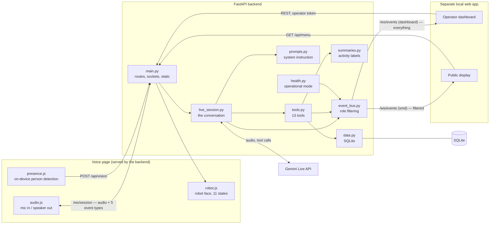

# THE HOST

A real-time voice and vision AI host for a food stall: it notices a guest, greets them
unprompted, talks, recommends, takes a confirmed order, remembers returning guests by the
name they spoke, and announces orders when they are ready.

THE HOST was built for **Bite & Pour**, a student food stall at a university business gala.
It runs on one laptop, uses only free-tier services, and is designed so that every number on
a screen comes from the database — never from a guess.

---

## What it does

1. A guest walks up. The browser's on-device detector notices a person and reports presence
   to the backend, which opens a conversation on its own — nobody has to press anything.
2. THE HOST greets the guest in its own voice and listens. Speech goes both ways over one
   WebSocket as raw audio; the transcript appears live on the operator's screen.
3. The guest asks what's good. THE HOST checks the real menu, recommends something that is
   actually in stock, and answers questions about the stall.
4. The guest orders. THE HOST reads the order back, waits for a clear spoken yes, and only
   then creates it. An unconfirmed draft is never a real order.
5. If the guest gives a name, THE HOST remembers it. Next time it greets them by name and
   knows their usual. It never recognises a face.
6. The guest can hold something up and ask "what is this?" — or THE HOST can ask the page
   for a picture itself when a question needs eyes.
7. The operator marks the order ready. THE HOST waits for a gap in the conversation and
   then announces it out loud, and the public display shows it.

## Key features

- **Unprompted greeting** from on-device presence detection — no wake word, no button.
- **Live voice both ways** through the Gemini Live API (16 kHz in, 24 kHz out).
- **Vision on demand**: the guest can show the camera something, and THE HOST takes a
  picture itself when the guest asks it to look.
- **13 tools** the model can call, each validating its own input and reading live data.
- **Two-step confirmed orders**: nothing is placed without a spoken yes.
- **Name-based memory**, never face recognition.
- **An 11-state conversation machine** that drives the robot face and the dashboard label.
- **One event bus, two audiences**: the operator's dashboard sees everything; the public
  screen is filtered in the backend so a guest's name can never reach it.
- **Operator controls**: pause, take over, end a conversation, advance or cancel an order,
  mark an item sold out, re-announce, correct or forget a visitor.
- **Honest failures**: every failure produces a plain spoken sentence and a visible mode
  change, never a traceback and never invented data.

## Architecture



Two WebSockets, deliberately separate:

- **`/ws/session`** is the audio path. It carries binary PCM both ways and only five JSON
  event types. A slow or dead observer can never touch it.
- **`/ws/events`** is a read-only observer stream. Everything published goes through it,
  filtered per role, with a per-socket send timeout so a stuck client is dropped instead of
  stalling a conversation.

## How it works

**Conversation state machine.** One value at a time, sent only when it really changes:
`IDLE`, `GREETING`, `SEEING`, `LISTENING`, `THINKING`, `SPEAKING`, `RECOMMENDING`,
`TAKING_ORDER`, `ANNOUNCING`, `REMEMBERING`, `NEEDS_HELP`. While an order is being taken the
label holds at `TAKING_ORDER`; only `SEEING`, `REMEMBERING`, `ANNOUNCING` and `NEEDS_HELP`
may interrupt it, each returning to the resting state at the end of the turn. The
conversation ends after 45 seconds of real silence, or gently after about 8 minutes: audio
still playing and a guest still talking both count as activity, so neither a long answer
nor a reply is ever cut off mid-sentence. It also ends if nobody has been in front of the
camera for 20 seconds, so THE HOST never talks to an empty room.

**Waking up.** A guest never has to press anything. THE HOST greets whoever walks up, and
once a conversation is over it can also start again on speech alone — but only when a face
is close to the counter **and** looking at the screen **and** a voice is heard for more
than half a second. All three together, because sound on its own cannot tell a guest from
two people chatting beside the stall. While the booth waits, the microphone is open for a
loudness reading only: nothing is recorded, and no audio leaves the browser until a
conversation actually starts.

**The polite wrap-up.** At about 8 minutes THE HOST is asked to say goodbye in one short
sentence rather than the screen cutting the conversation off. It waits for a gap first —
never mid-order, mid-answer or mid-sentence — and only then ends, so the last thing a guest
hears is a thank-you and not silence.

**Two-step orders.** `build_order` creates a draft in `PENDING_CONFIRMATION`,
`signal_confirmation_request` puts the question on screen, and only `confirm_order` — after
a clear spoken yes — makes it real. A draft that is abandoned is cancelled after five
minutes, and a draft dies with its session rather than surviving as a half-order. From
there the operator moves it `CONFIRMED → PREPARING → READY → COLLECTED`, one step at a time;
`CANCELLED`, `FAILED` and `REQUIRES_ATTENTION` are the other three statuses, the last two
operator-only.

**Role-filtered event bus.** Every event is stamped once with a monotonic `event_id`, a
local timestamp and a session id, then delivered to each observer through a filter table.
The public display never receives the activity feed, memory updates, vision detections or
system status; guest names are stripped from every order it does receive, and it sees only
completed transcript lines, never partials.

**The announcement.** Moving an order to `READY` flips an atomic `announced` flag, so the
same order can never be announced twice. The order-ready event goes to both screens, and if
a conversation is running THE HOST speaks the announcement itself. It waits for a gap: an
announcement is never injected while a model turn is producing output, while the guest is
mid-sentence, or while the voice page's microphone meter says the guest is talking, because
doing so makes the model cut its own sentence off. Even in a gap it waits 0.8 seconds and
looks again, since a guest's first syllable reaches the room before it reaches the backend.
Deferred announcements leave one per turn end, or as soon as the guest falls silent.

**Memory by name, never by face.** A profile is created only when a guest clearly says a
name. The key is the lower-cased name; there is no biometric data anywhere in the system,
and the camera is used only for presence counting and for pictures the guest asks about.
An operator can correct a misheard name or delete a profile outright.

**What the menu can say.** Besides a name, category, price and description, a menu item may
carry four optional facts: `ingredients`, `allergens`, `tags` (any of `spicy`, `sweet`,
`vegetarian`, `cold`, `hot`) and `add_ons` — the extras the stall genuinely offers. They are
answered from the data or not at all: a field that is missing means **unknown**, never
"none", so THE HOST says it does not have that detail and points the guest at the counter
rather than inventing a garnish. Allergy questions are never answered with a guarantee.
Fill these in alongside the real menu in `data/menu.json`; leaving one out is always safe.

## Tech stack

| Layer | Choice |
|---|---|
| Backend | Python 3.13, FastAPI, Uvicorn |
| AI | Gemini Live API via `google-genai` (audio in/out, function calling) |
| Storage | SQLite (single local file) |
| Voice page | Vanilla HTML/CSS/JavaScript, Web Audio API, MediaPipe for presence |
| Tests | pytest |

No paid services, no cloud database, no build step for the voice page.

## Getting started (Windows)

**Prerequisites:** Python 3.13, Google Chrome, and a Gemini API key from Google AI Studio.

```powershell
# 1. Create and activate a virtual environment at the repository root
python -m venv .venv
.\.venv\Scripts\Activate.ps1

# 2. Install the backend dependencies
pip install -r campusai-v1\backend\requirements.txt

# 3. Create your own configuration from the example and add your key
Copy-Item campusai-v1\backend\.env.example campusai-v1\backend\.env
notepad campusai-v1\backend\.env

# 4. Run the backend from the backend folder
cd campusai-v1\backend
python -m uvicorn main:app --host 127.0.0.1 --port 8000
```

Then open **http://localhost:8000/** in Chrome and allow the microphone and camera. The page
greets a guest on its own, so it must be a visible window of its own — presence detection
pauses while the tab is hidden. A partly overlapped window is fine; a minimised one is not.

`.env` is never committed and the key is only ever read by the backend process. It is never
logged, never sent to a browser, and never written into any file by the application.

**Hard-refresh note.** The backend now serves every static file with `Cache-Control:
no-store`, so the browser cannot keep an old copy of the voice page. If you have an older
build cached from before that change, load the page once with **Ctrl+Shift+R** to clear it.

## Configuration

Every value lives in `campusai-v1/backend/.env`; `campusai-v1/backend/.env.example` lists
them all. **Put no real secret in any file that is committed.**

| Variable | Purpose | Default |
|---|---|---|
| `GEMINI_API_KEY` | Your Gemini API key. Required; the backend refuses to start without it. | none |
| `GEMINI_LIVE_MODEL` | The Gemini Live model to connect to. | `gemini-3.8-live` |
| `GEMINI_VOICE` | The prebuilt voice THE HOST speaks with. | `Sulafat` |
| `OPERATOR_TOKEN` | Shared secret for every privileged endpoint and the dashboard event stream. Without it those are all refused. | none |
| `AGENT_NAME` | The name the agent uses for itself. | `THE HOST` |
| `STALL_NAME` | The stall the agent says it works at. | `Bite & Pour` |
| `MENU_JSON_PATH` | Seed file the menu table is loaded from on first run. | `./data/menu.json` |
| `BUSINESS_INFO_JSON_PATH` | Seed file for the stall facts the agent may state. | `./data/business_info.json` |
| `DB_PATH` | The SQLite file. | `./data/campus_ai.db` |
| `FRONTEND_DIR` | Folder served as the voice page. | `../frontend` |
| `CORS_ALLOW_ORIGINS` | Comma-separated origins allowed to call the API. No wildcard. | `http://localhost:8080,http://localhost:5173,http://localhost:4173` |
| `PORT` | Port recorded for the frontends to use. | `8000` |
| `VISION_SEND_MODE` | How a snapshot reaches the model: `client_content` (picture and question as one turn) or `realtime` (two calls). | `client_content` |

## REST and WebSocket reference

**Token** means the `X-Operator-Token` header. Everything that returns guest data or changes
anything requires it.

| Endpoint | Purpose | Token |
|---|---|---|
| `GET /health` | Status, model, menu row count, operational mode and per-component health | no |
| `GET /api/menu` | The menu, for the public display's carousel | no |
| `POST /api/vision` | The browser reporting presence and detections. A report, never a command | no |
| `GET /api/orders` | Orders for the Orders panel, with tab counts | yes |
| `GET /api/visitors` | Recent visitor profiles | yes |
| `GET /api/activity` | Recent activity-feed entries | yes |
| `GET /api/analytics` | Real aggregates for today | yes |
| `GET /api/metrics` | Today's conversation, order, failed-tool and connection-failure counts | yes |
| `POST /api/orders/{id}/status` | Advance, cancel, fail or flag an order | yes |
| `POST /api/menu/{name}/availability` | Mark an item sold out or available again | yes |
| `POST /api/operator/pause` | Pause THE HOST; any running conversation ends cleanly | yes |
| `POST /api/operator/resume` | Return to the computed mode | yes |
| `POST /api/operator/takeover` | The operator handles this one personally | yes |
| `POST /api/operator/takeover/end` | Hand it back | yes |
| `POST /api/operator/end-session` | Force-end whatever conversation is running | yes |
| `POST /api/operator/retry-connection` | Check the AI service right now and update the mode | yes |
| `POST /api/operator/announce` | Repeat the announcement for a ready order | yes |
| `PATCH /api/visitors/{name_key}` | Correct a misheard name or a wrong favourite | yes |
| `DELETE /api/visitors/{name_key}` | Forget a visitor completely. Orders are untouched | yes |

| WebSocket | Purpose |
|---|---|
| `/ws/session` | The conversation: binary audio both ways plus `agent_state_changed`, `speech_transcript`, `interrupted`, `error` and `capture_request` |
| `/ws/events?role=dashboard` | Read-only observer stream for the operator. Also needs the operator token, passed as a query parameter because a browser cannot set a header on a WebSocket handshake |
| `/ws/events?role=smd` | Read-only observer stream for the public display, filtered in the backend |

**What the voice page sends back on `/ws/session`:** microphone audio as raw PCM,
`vision_frame` (one JPEG, when the guest shows the camera something or THE HOST asks for a
picture), `text_input` (a typed line, when the microphone is unavailable) and
`voice_activity` — `{"active": true}` or `{"active": false}`, nothing else. It comes from
the microphone meter the robot face already uses: no audio and no level ever leaves the
page in it. It exists so the backend knows the guest has started speaking before Gemini
transcribes them, which is a second or more earlier, and can hold an announcement back.
Then `wrap_up`, sent once when the conversation reaches its 8-minute cap, which asks THE
HOST to thank the guest and say goodbye in one sentence. Last, `session_end` with the reason
the page stopped (`timeout`, `cap`, `user`, `absent`), which the backend records; the socket
closing is what actually ends the conversation.

**Events on `/ws/events`.** Every one carries `event_id`, `timestamp` and `session_id`.

| Event | Meaning |
|---|---|
| `state_snapshot` | Sent once on connect: boot id, mode, current state, presence, active orders |
| `agent_state_changed` | The conversation state changed |
| `person_detected` / `person_left` | The browser's detector saw someone arrive or leave |
| `visitor_identified` | A spoken name matched a stored profile |
| `speech_transcript` | A line of speech, partial or complete, from the guest or the agent |
| `interrupted` | The guest talked over the agent and its audio was cut |
| `order_created` / `order_updated` | An order was drafted, or its status changed |
| `order_ready` | An order became ready and should be announced |
| `menu_updated` | An item was marked sold out or available |
| `memory_updated` | A visitor profile changed. Dashboard only |
| `recommendation` | The agent recommended a specific item |
| `vision_update` | What the browser's detectors currently report. Dashboard only |
| `agent_activity` | One line for the activity feed. Dashboard only |
| `system_status_changed` | A component the backend can actually observe changed. Dashboard only |
| `operational_mode_changed` | `ONLINE`, `OFFLINE`, `PAUSED` or `OPERATOR_TAKEOVER` |
| `capture_request` | The agent is asking the voice page for one picture. Never public |
| `error` | A plain, human-readable failure message |
| `heartbeat` | Every 10 seconds, so a client knows the stream is alive |

## Testing

```powershell
cd campusai-v1\backend
..\..\.venv\Scripts\python.exe -m pytest -q
```

**326 tests pass.** They cover the data model, all 13 tools, the system prompt, the event bus
and its role filtering, the activity labels, the state machine, both WebSockets, every REST
endpoint including its error cases, the operator controls, visitor correction, metrics and
the order-ready announcement with every condition that defers it. The tools and the live
session are tested against fakes, so the suite needs no API key and makes no network call.

## Reliability, privacy and security

- **Graceful failure.** Every failure path ends in a plain spoken sentence, a `NEEDS_HELP`
  state and an honest mode change. Real network failures during testing produced a clean
  recovery in under four seconds with no traceback. A tool that fails returns an error the
  model must tell the guest about; it never pretends to have succeeded.
- **A dropped connection is rebuilt, not given up on.** If the Gemini connection dies
  mid-conversation — the real case was a keepalive timeout that left THE HOST silent for
  thirty-four seconds — the conversation is not ended. The browser socket stays open, the
  page flushes whatever was half-played, and the backend reconnects: first with a session
  resumption handle, so the model still has the conversation behind it, and failing that on
  a fresh connection carrying any open order draft forward. THE HOST then apologises briefly
  and asks the guest to say that again. The order being built, the guest's name and any
  pending announcement all survive it, because it is the same conversation. Only if both
  attempts fail does the conversation end the honest way. `/health` reports `RECOVERING`
  while this is happening and `ONLINE` again the moment it works.
- **A conversation that goes quiet is noticed.** If Gemini has heard the guest, or has been
  handed a tool result, and then nothing comes back for eight seconds — or a reply stops
  mid-word and never finishes — that is treated as a dead connection and recovered the same
  way. Silence on its own never triggers it: a guest who simply says nothing is not a fault.
- **The guest's end is honoured immediately.** Ending the page used to be noticed only after
  the Gemini connect had finished, which could leave a finished conversation holding the
  booth for six seconds and refuse the next guest. Closing the page or pressing Done now
  cancels the connect in progress and frees the booth at once.
- **Never invented data.** The agent reads availability, prices, orders and stall facts from
  the database on every call. The analytics and metrics endpoints return real counts or an
  explicit error — never a placeholder number.
- **The API key stays server-side.** It is read once by the backend process, never logged,
  never included in an error message, and never sent to a browser.
- **Operator token redaction.** A browser cannot set a header on a WebSocket handshake, so
  the dashboard's token has to travel in the URL — where the web server's access log would
  normally print it. A logging filter rewrites it before any line is written.
- **The public screen is filtered in the backend.** Role filtering is server-side, not a
  frontend convention: the public display cannot receive a guest's name, the activity feed,
  memory updates, vision detections or partial transcripts even if it asks.
- **No face recognition, ever.** Visitors are matched by a name they said out loud. The
  camera reports a person count and takes pictures the guest asks about; no image is stored
  and no biometric data exists anywhere in the system.
- **The idle microphone is a loudness meter, nothing more.** So that a guest can start
  talking without pressing anything, the microphone stays open while the booth waits. It is
  read only as a single loudness number, the same one that animates the robot's face. While
  no conversation is running nothing is recorded, nothing is transcribed, and no audio and
  no level ever leaves the browser — the first audio to reach the backend is the audio of a
  conversation that has already started.
- **Guest words are not put on the screen.** The booth display faces the queue, so a guest's
  own transcript lines are not printed on it; only THE HOST's replies appear. The backend
  still receives them, because the conversation needs them.
- **Honesty rules in the prompt.** The agent may not claim to have cancelled, created or
  remembered anything it did not actually do through a tool call, and may not state a fact
  about the stall it did not look up.
- **Minimal attack surface.** No tool takes arbitrary code or SQL, every tool validates and
  truncates its inputs, and only one conversation can run at a time.

## Project structure

```
campusai-v1/
├── backend/      the FastAPI backend — all the code described above, plus its tests
└── frontend/     the voice page: the screen that listens, speaks and watches
```

The `campusai-v1` folder name is historical: the conversational engine began as a university
timetable assistant called CampusAI and was migrated to this restaurant domain. The database
filename comes from the same history. Both names were kept deliberately rather than renamed
mid-project.

The `backend/` folder at the repository root is **legacy code from an earlier, unrelated
project and is not used** by THE HOST.

The operator dashboard and the public display are a separate local web app. They are clients
of the contract above and are not part of this repository.

## Roadmap

- Load the stall's final menu and prices in place of the current seed data.
- Connect the operator dashboard and the public display to this backend.
- Work through every row of the failure matrix deliberately, then a full event-day rehearsal.

## Credits

Built by **Rehman Ayoub** (lead), **Saad Saleem** and **Umair Saddiqui** — BS Computer
Science, Government College University Faisalabad.
